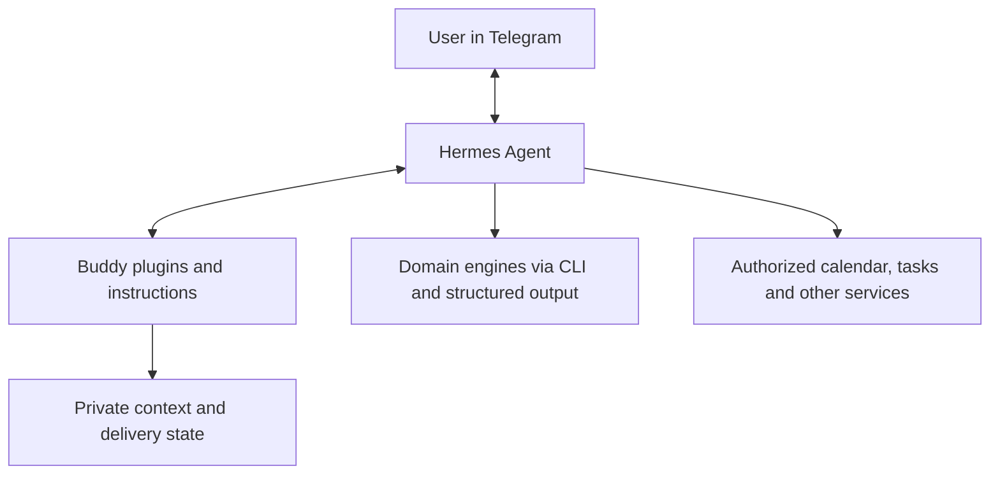

# AI Buddy

AI Buddy is a personal assistant built around [Hermes Agent](https://github.com/NousResearch/hermes-agent). It brings everyday questions, planning, learning and domain-specific workflows into one Telegram conversation.

This repository contains the integration code, assistant instructions and architecture documentation that connect those pieces. It is intended for developers exploring how to build a personal assistant with durable context, bounded initiative and clear operational boundaries.

Hermes is a separate upstream runtime. Domain engines and private runtime data live outside this repository. This is an integration reference, not a standalone application or a one-command installer.

## What Buddy does

- **One conversation:** handle requests, reminders and useful reports in the same Telegram chat.
- **Context and continuity:** retain source-backed decisions and preferences for later reviews, while allowing a greeting to start a fresh daily session.
- **Useful initiative:** prepare private daily and weekly reviews; send a note only when there is a fresh, actionable signal within a deterministic notification budget.
- **Domain coordination:** call separate engines for product discovery, recovery and training, and learning through documented CLI contracts.
- **Web research:** use hosted search and cited summaries, with an optional paid API fallback.
- **Natural communication:** give concise answers, complete longer reports and brief progress updates during substantial work.

These capabilities depend on the integrations and data sources an operator configures. Publishing the source does not grant access to any running assistant, account or personal data.

## How it fits together



Hermes owns conversation handling, tools, memory and scheduling. Buddy integrations add specific interaction policies. Domain repositories own their business logic, tests and data contracts; they do not become part of the assistant runtime.

## Explore the integrations

| Integration | Responsibility | Entry point |
| --- | --- | --- |
| Heartbeat | Bounded source collection, private reviews, context ledger and conditional delivery | [Guide](integrations/buddy-heartbeat/README.md) |
| Session policy | Greeting-triggered daily sessions with safeguards for active work and replayed inputs | [Guide](integrations/buddy-session-policy/README.md) |
| Live progress | Completed commentary and scoped waiting notices during a real user task | [Guide](integrations/buddy-live-progress/README.md) |
| OpenAI web | Hosted search, explicit page summaries and provider fallback | [Guide](integrations/buddy-openai-web/README.md) |
| Persona | Reusable role, communication and report instructions | [Guide](integrations/buddy-persona/README.md) |
| Google Calendar | Skill instructions for authorized event reads and changes | [Skill source](integrations/google-calendar/SKILL.md) |

The Calendar directory contains a skill, not a bundled Google OAuth client. Heartbeat expects separately installed domain CLIs and authorized data sources. Plugin manifests and Python source are included; account setup and production configuration are operator responsibilities.

## Get started

To read the design or run isolated tests, clone this repository and use Python 3.11 or later:

```bash
git clone https://github.com/bknstn/ai-buddy.git
cd ai-buddy
PYTHONDONTWRITEBYTECODE=1 python3 -m unittest discover -s integrations/buddy-heartbeat -v
PYTHONDONTWRITEBYTECODE=1 python3 integrations/buddy-session-policy/test_policy.py
PYTHONDONTWRITEBYTECODE=1 python3 integrations/buddy-live-progress/test_progress.py
```

These suites use synthetic fixtures. They do not require live credentials or send Telegram messages. Native Hermes tests are skipped when its runtime is unavailable. The web backend and native gateway checks need a separate Hermes environment; see [development and validation](docs/development.md).

To adapt Buddy to your own installation:

1. Set up Hermes separately, following its upstream instructions.
2. Read the relevant integration guide and its compatibility limits. The recorded compatibility baseline is Hermes **v0.21.7**; session and progress plugins use private gateway interfaces.
3. Configure your own private runtime home, owner/chat identifiers, credentials and domain workspaces outside Git.
4. Install only the integrations you need, validate them against that runtime and enable scheduled work only with explicit authorization.

See the [operations guide](docs/operations.md) for the reference layout and deployment workflow. Running a collector or delivery script is an operational action, not a local setup step.

## Design and documentation

- [Architecture](docs/architecture.md): component boundaries, context flow and trade-offs.
- [Architecture decisions](docs/adr/README.md): numbered records in chronological order, starting with ADR 0000.
- [Development](docs/development.md): local checks and runtime-dependent validation.
- [Operations](docs/operations.md): instance selection, deployment and maintenance.
- [Idea Maze design scope](docs/plans/idea-maze.md): a domain-engine plan retained as design context.
- [Security and privacy](SECURITY.md): what belongs in source, secret scanning and disclosure.
- [Contributing](CONTRIBUTING.md): how to propose and validate changes.
- [Agent instructions](AGENTS.md): repository boundaries for coding agents.

README describes the project and how to use this repository. Historical decisions belong in ADRs; deployment logs, personal profiles, transcripts, credentials and runtime databases belong outside the public repository.

## License

The code and documentation in this repository are licensed under the [MIT License](LICENSE).

Hermes Agent and separately maintained domain engines are governed by their own licenses.
