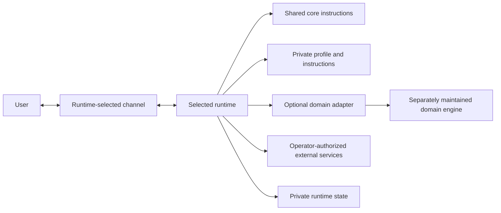

# Architecture

AI Buddy separates shared, reusable source from an assistant's private profile and the runtime that executes it. The public repository is a customization base; it is not itself a running assistant.

## Components

| Component | Responsibility | Location |
| --- | --- | --- |
| Shared core | Generic assistant and communication guidance | `core/` in this repository |
| Private profile | Instance name, timezone, runtime selection, enabled features and private instructions | Operator-selected location outside the clone |
| Runtime module | Translate the starter's capabilities into one runtime's configuration, hooks and integrations | `runtimes/<runtime-id>/` |
| Upstream runtime | Conversation handling, tools, provider/channel adapters, scheduling and runtime state | Separately installed and maintained |
| Domain adapter | Optional interface from assistant actions to a separately owned domain engine | `examples/` as a synthetic contract example |
| Domain engine | Business logic, data, tests and artifacts for a chosen domain | Its own repository or service |

Hermes is the initial documented runtime module. Its module owns Hermes-specific plugins, scripts, prompts and policy. The Hermes Agent checkout is separate from this repository. The recorded integration compatibility baseline is v0.21.7; that version is not a claim about the latest upstream release. See the [runtime adapter guide](../runtimes/README.md) and [Hermes module guide](../runtimes/hermes/README.md) for the current contracts and limits.

The profile schema currently contains `schema_version`, an assistant name and timezone, a runtime ID and home, and an explicit feature list. The default values are examples, not a prescribed persona, provider, channel, daily schedule or domain track. Private custom instructions belong in the profile's `instructions/` directory and can be tailored without changing public defaults.

## Request and configuration flow

The exact channel, provider, execution location and storage are choices made when a runtime is installed and configured. A profile plan can describe selected files and capabilities, but it does not prove that the runtime loads those files, has access to services, or is ready to serve a user.

## Portability boundary

Core instructions and the profile shape are runtime-neutral. Runtime modules own the mapping into a concrete execution environment. A module may rely on runtime-specific hooks or interfaces; those dependencies must be documented and checked against the selected runtime version.

Hermes is the first module, not evidence that every behavior is portable. Existing Buddy integrations were designed around Hermes and some use private gateway interfaces. Other runtimes need their own modules and compatibility work. Until an alternate module exists and is validated, do not describe the legacy integrations as runtime-independent.

The starter CLI validates profile structure and renders a local plan. It does not install integrations, write into an upstream runtime home, alter services, configure credentials, contact external systems, or start a conversational assistant.

## Security and authorization boundaries

- Keep configuration and custom instructions in a private profile outside the repository. Use OS permissions appropriate to the host; the CLI creates the config file with private permissions.
- Treat external service access, sending messages, scheduled work and domain commands as separate capabilities. Listing a feature in a profile does not grant authorization or create working credentials.
- Keep credentials in the runtime's supported secret mechanism. Do not put them in the profile config, prompts, logs, examples or version control.
- Prefer read-only checks first, synthetic data for validation and explicit review before enabling writes or unattended activity.
- Domain repositories own their data contracts and implementation. The assistant should pass explicit workspace/context and respect the engine's actual output.
- Instructions influence model behavior; runtime code and external service permissions enforce access. Do not rely on prose alone as a security boundary.

See [operations](operations.md) for generic rollout practices and the [ADRs](adr/README.md) for the design history.
